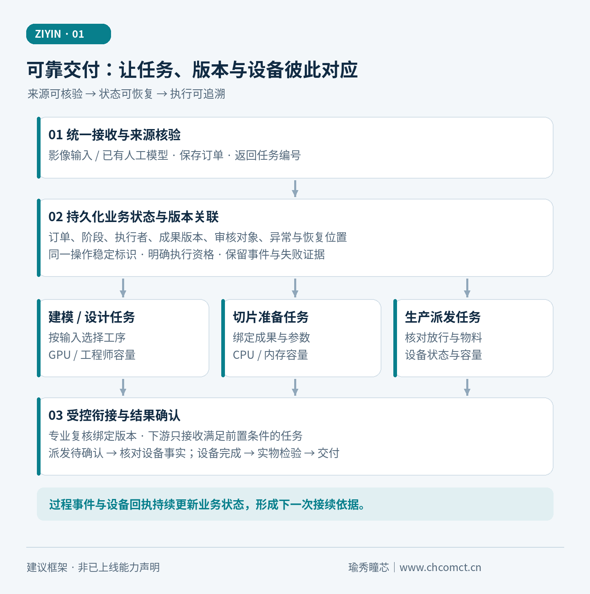
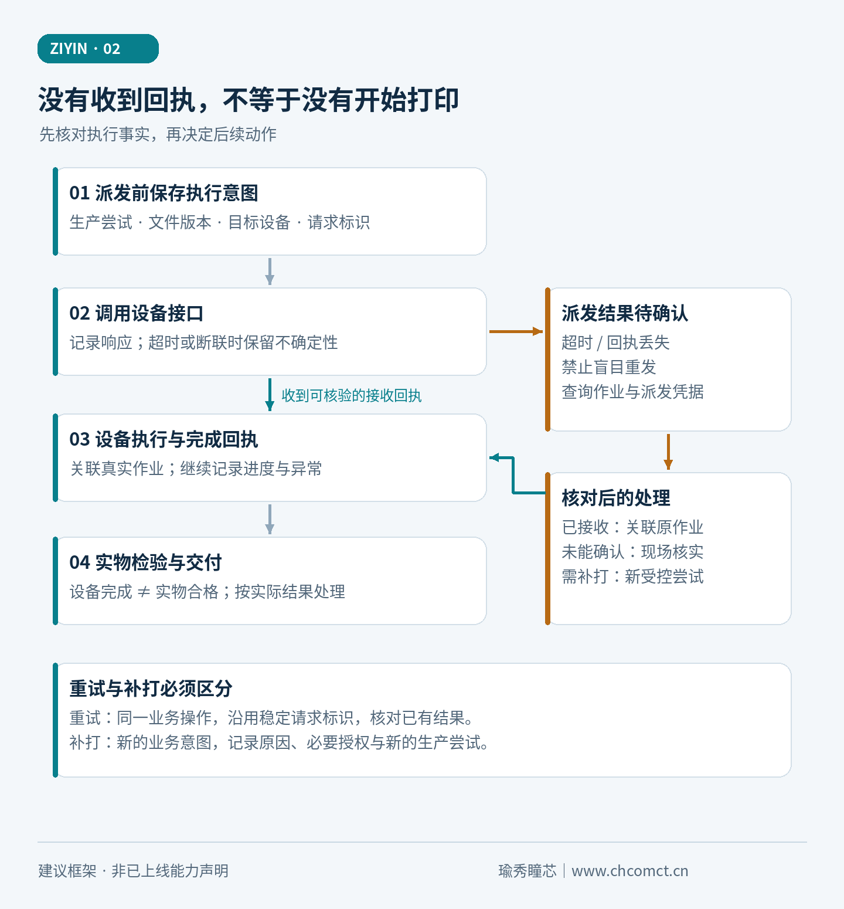

# 从“会生成”到“可交付”：子殷 chcomct SI 的可靠性工程路径

作者：瑜秀瞳芯

文章类型：工程方法与实践观察｜2026年11月17日

医疗 AI 与医学 3D 打印正在进入协同工作的新阶段：需求可以通过自然语言描述，模型生成、工程设计、切片与设备调度也可以由软件连续承接。当一次演示能够完成，下一步就要回答更具体的问题：多个人同时提交任务时会发生什么？服务中断后如何接续？同一条打印指令被重复发送时，系统如何判断？接手的工程师又凭什么确认眼前文件就是获准生产的版本？

这些问题决定 AI 能力能否成为可持续运行的医工服务。本文结合子殷 chcomct SI 的小试与多中心协同需求，提出以持久化任务、幂等操作、版本关联、受控设备执行和异常验证为核心的工程路径。文中框架与验收要求属于建设建议；现有小试记录仅用于说明问题，不能据此宣称全流程可靠性、多中心容量或临床效果已经得到验证。

关键词：医疗人工智能；医学3D打印；工作流；幂等性；任务调度；可追溯性；人在环

## 一、AI 加速之后，交付责任需要落到系统中

子殷面向的工作包含两类入口：一类从医学影像开始，经过建模与工程处理；另一类接收已经完成的人工模型，继续进行制造设计、复核、切片与生产。两类入口可以复用后续环节，但来源核验、输入要求和需要执行的工序并不相同。已有人工 STL 的任务，不应因为平台默认从影像开始，就被迫重复建模。

同时，自动执行与人工在环是两种明确的任务路径。系统应记录哪些步骤自动完成、哪些步骤由工程师修正、哪些判断由具备相应职责的人员确认。选择自动路径，也必须符合该用途既定的放行条件。

对小试材料的检查提示，模型提交成功、设备开始工作与正式订单完成，分别需要不同证据支持。一组文件可以有效上传，设备也可以实际运行，但仍需核对其版本、订单归属和完成回执。把这些状态合并成一个“成功”，会掩盖尚未完成的业务环节。

因此，平台应以可检查的业务记录承接交付责任：每次操作作用于哪个订单、哪个版本、哪项工序，产生了什么结果，下一步由谁处理。

## 二、先区分接单并发、计算并发与设备并发

“支持多人使用”至少包含三个层次。

接单并发，是多个用户提交需求时，系统能够可靠保存订单并返回可查询的编号。计算并发，是 GPU、CPU、内存和磁盘允许多少项建模或切片任务同时执行。设备并发，则取决于可用打印机、设备能力、材料条件和现场准备情况。

三个同事同时提交订单，不意味着必须同时启动三个重型建模进程。合理的行为是先完成接收，在界面显示排队原因，再依据实测资源容量安排执行。正在等待人工复核的订单，不应继续占用计算执行名额；某个任务失败，也不应无期限阻塞其他具备执行条件的任务。

对多中心场景，还需区分“资源空闲”与“资源可用”。跨中心调度必须同时满足数据访问授权、网络边界、软件版本和设备适配条件。院内隔离部署的任务应能依赖院内服务保存与执行，不能把公共云连接作为所有工作流的隐含前提。

图1｜建议架构。箭头表示受控衔接，不表示所有阶段已经上线；已有人工模型从来源核验后进入相应工序，实际审核节点按用途和既定流程确定。

## 三、幂等性：把“再试一次”与“再做一件”区分开

幂等性是指同一业务操作被重复请求时，不产生额外的业务效果。网络抖动、用户重复点击、执行程序重启，都可能导致重复请求。仅在页面上禁用按钮，不能覆盖这些情况。

对 SI，可为一次明确的操作生成稳定的请求标识，并绑定订单、操作类型、输入版本与必要参数。相同标识与相同参数再次到达时，返回已有处理状态；相同标识却携带不同内容，应拒绝并提示冲突。结果与去重记录需要协调提交，避免出现“已执行但未记账”或“已记账但未执行”的空隙。这一设计思路与 AWS 对安全重试的工程说明一致[1]。

这里必须保留真实业务意图。用户明确要求补打一件，是新的生产尝试，应有新编号、原因及必要授权；由于没有收到响应而重发同一请求，则属于重试。不能单纯依据文件内容相同，就把两种情况混为一谈。

幂等保护应贯穿关键业务效果：订单创建、任务领取、成果登记、生产派发，以及验收后的工序贡献入账。一次操作重复到达，不应让一项工作变成两份订单、两次派发或两次贡献。

## 四、队列、事务与锁分别解决什么问题

队列负责保存待执行工作并协调处理节奏。Kafka 等消息系统可以承担事件传递，但消息被消费不等于业务效果已经安全完成。消费者是处理消息的程序；Rebalance 是消费组重新分配处理责任。若外部操作已经完成，而处理位置尚未可靠提交，故障恢复或重新分配后就可能再次处理相关消息。

Kafka 官方文档将其内部事务处理与外部目标系统区分开来：外部系统的恰好一次效果需要额外配合[2]。因此，“消息只处理一次”不能直接推导成“打印机只启动一次”。

数据库事务适合协调同一数据库内的相关变更。例如，把订单状态更新和待发送事件一起保存，再由后台程序发送事件，可以缩小数据库与消息系统分别写入造成的不一致窗口。这种事务发件箱模式仍可能重复投递，接收方仍需去重[3]。

锁用于协调同一时刻谁能操作共享资源。对 SI，可以约束同一任务的有效领取者及同一设备的派发者。长任务还需要心跳、租约和过期结果校验：旧执行者失去资格后，即使恢复运行，也不能覆盖新执行者的结果。仅添加一个有到期时间的锁，不足以自动解决所有重复执行问题。

具体组件应服从现有架构和运维能力。在负载允许时，可以先采用现有数据库支持的原子领取与持久化任务表；是否引入 Kafka、Redis 集群或 Kubernetes，应依据测量结果和实际部署需求决定。

## 五、实体打印必须保留“结果不确定”状态

软件中的失败通常可以重试，实体设备已经发生的动作却不能靠回滚数据库撤销。SI 尤其需要区分以下两件事：没有收到设备回执，以及设备没有收到指令。

当派发请求超时，设备可能尚未执行，也可能已经开打，只是回执未返回。此时直接将任务标记为“失败，可以重发”，存在重复执行风险。建议将其保存为“派发结果待确认”，查询设备作业、已有派发凭据及可核验的文件信息，再决定后续处理。

如果设备接口缺少可稳定识别的作业编号，或历史状态不足以排除已经执行，就应保留不确定性并安排现场核实。无法确认的任务，不应被自动重发来制造“流程继续”的表象。对于明确需要返工或补打的情况，应创建新的受控生产尝试，并保留前一次记录。

图2｜建议的设备执行状态处理。结果待确认时先核对事实；设备完成后仍需实物检验，不能直接推定交付合格。

## 六、跨窗口接续，要读取正式状态与版本关系

聊天记录可以提供背景，正式任务记录才应决定下一步。一次可靠接续至少应恢复：订单与来源、当前阶段、执行者、成果版本、审核对象、设备尝试、异常原因以及下一步允许的操作。

对于骨盆等由多个部件组成的任务，可追溯链应贯通原始模型、制造衍生文件、切片产物、生产尝试与设备回执。插杆、插孔或拆件设计改变后，应生成新的衍生版本并保留父子关系。文件摘要能够帮助确认内容是否一致，但不能代替几何质量、医学判断或实物检验。

审核结论也需要绑定具体版本。新的模型替换旧模型后，应根据变化及既定规则判断是否需要重新复核，不能默认沿用旧版本结论。已完成工作的恢复应尽量复用已确认成果；输入、参数或程序版本改变时，则需要明确哪些后续产物仍然有效。

由此形成的“记忆”，包含可执行程序、工艺参数、适用范围和验证证据。成功样件可以成为工艺参考，但患者相关几何、标识和连接位置不能机械复制到另一个病例。

## 七、让监控回答“为什么没交付”

CPU 利用率正常，并不意味着订单能够完成。SI 的运行监控应同时覆盖基础资源与业务状态。

基础指标可以包括 GPU 显存、工作进程心跳、接口错误率和设备连接状态；业务指标则包括排队数量、最老任务等待时间、阶段停留时间、重试次数、待确认派发数量，以及缺失文件或设备关联的任务数。Prometheus 可采集时间序列指标并执行告警规则，Grafana 可用于展示这些指标[4]。

每条重要告警还应对应处理动作：谁接手、先查看什么证据、哪些操作允许自动恢复、什么时候必须停止并转交人工。限流与熔断用于保护过载或持续故障的环节；重试应设置次数、间隔与终止条件，避免多个程序不断重试而放大故障[5]。

日志和指标中应使用受控任务标识，避免把患者身份、原始影像内容或访问凭据带入不必要的监控渠道。

## 八、AI 的价值，需要由工程验证兑现

AI 编程工具可以帮助理解代码、生成候选修改和分析日志。Agent 可以组合工具完成任务，MCP 为连接外部工具与数据提供标准化接口[6]，RAG 可以检索已有工艺与历史记录。多智能体协作也可以承担相对独立的分析与核验工作。

这些能力进入 SI 时，应共同遵守明确的接口权限、状态转换与版本规则。检索到一条历史经验，不等于它适用于当前模型；AI 给出修复建议，不等于建议已经经过验证；多个智能体都报告完成，也不等于数据库与设备产生了预期且唯一的效果。

对关键修改，建议建立“业务要求—实现位置—故障场景—验收证据”的对应关系。例如，幂等校验的存在应关联重复提交测试；审核版本检查应关联旧结论放行新文件的拒绝测试；派发待确认状态应关联设备收到命令但回执丢失的模拟场景。

工程师的经验由此转化为团队可检验的规则。评价工程工作的价值，应观察合格交付、异常定位、修复后的回归结果与交接能力，而不能仅依据代码数量或操作速度。

## 九、下一阶段怎样验证

子殷下一阶段宜沿用既有架构，在隔离候选环境中先验证合成订单与模拟设备，再按授权范围验证真实链路。优先覆盖以下场景：

1. 多人同时接单：每次有效需求都有明确结果，资源不足时进入可查询队列。
2. 重复请求与参数冲突：同一操作不增加业务效果，标识复用但内容改变时明确拒绝。
3. 单任务失败与人工等待：不无期限阻塞其他可执行任务，失败原因和恢复入口保留。
4. 进程中断与恢复：核对最后可靠状态，拒绝失去执行资格的旧进程回写结果。
5. 成果版本变化：旧审核不能错误地放行未经确认的新版本。
6. 设备回执丢失：进入待确认流程，不能把超时自动解释为可以重新派发。
7. 完成、质检与贡献：设备完成、实物合格、交付完成分别记录，贡献按规定节点登记且不重复。

验收报告应说明任务类型、输入规模、软硬件条件、并发配置、失败情况及人工接管。模拟接口测试可以证明特定控制逻辑，却不能代替真实算法推理、设备执行或医学用途验证。小规模通过也不能直接推算多中心的生产容量。

chcomct SI 的工程建设，应让一次成功逐步成为有依据、能复现、可交接的工作能力。随着这些证据不断积累，AI 才能在明确责任与受控条件下承担更多工作，帮助子殷把多中心医工协作落实为稳定的服务交付。

## 参考资料与说明

[1] Amazon Builders’ Library. [Making retries safe with idempotent APIs](https://aws.amazon.com/builders-library/making-retries-safe-with-idempotent-APIs/).

[2] Apache Kafka. [Design: Message Delivery Semantics](https://kafka.apache.org/design/).

[3] AWS Prescriptive Guidance. [Transactional outbox pattern](https://docs.aws.amazon.com/prescriptive-guidance/latest/cloud-design-patterns/transactional-outbox.html).

[4] Prometheus. [Overview](https://prometheus.io/docs/introduction/overview/).

[5] Amazon Builders’ Library. [Timeouts, retries, and backoff with jitter](https://aws.amazon.com/builders-library/timeouts-retries-and-backoff-with-jitter/).

[6] Model Context Protocol. [What is the Model Context Protocol?](https://modelcontextprotocol.io/docs/getting-started/intro).

[7] 子殷科技. chcomct SI 小试流程核验、提交后核验与成功案例接续记录，2026年11月15日至16日内部工程资料。本文仅讨论工程方法，不公开患者资料、内部访问地址或凭据。

延伸阅读：[从实验记录到组织研发资产：子殷医疗 AI 与 3D 打印研发的证据化实践](https://www.chcomct.cn/news/28a8a918-f305-48ec-98a1-d04fb1bacd10)。

利益关系与写作说明：本文围绕子殷科技研发实践撰写，存在组织利益关联，采用 AI 辅助资料整理与写作。本文为官网工程观点文章，未经期刊同行评议；提出的架构、指标与验收场景不表示全部已经实现或通过验证，也不构成临床效果或注册充分性的证明。

子殷科技｜[www.chcomct.cn](https://www.chcomct.cn)
