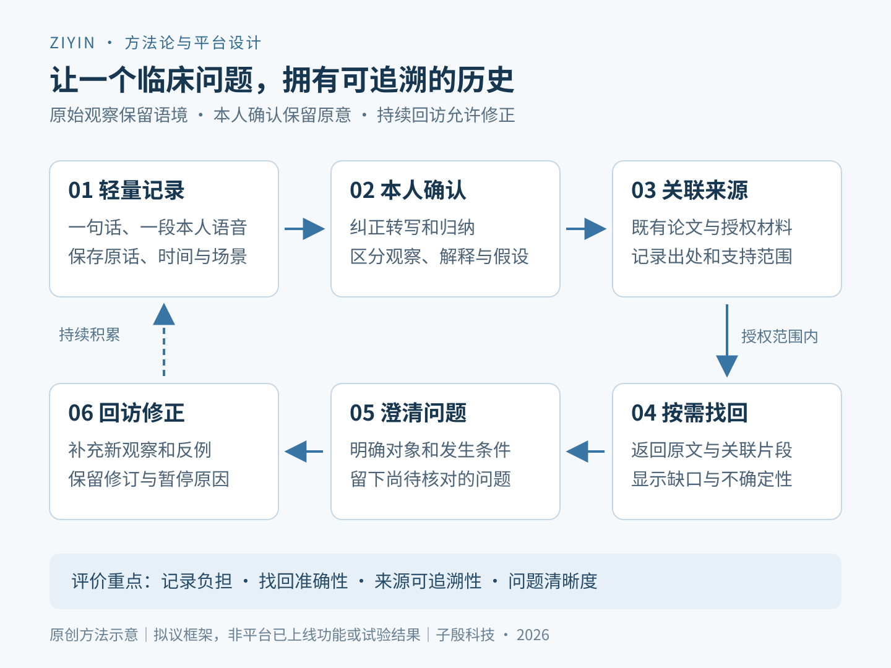

# 让临床发现成为可追溯的研究线索：医护日常观察的连续记录框架

作者：瑜秀曈芯｜子殷科技。本文依据作者对既有协作场景的经验陈述及公开资料形成，属于研究线索管理的方法论与平台设计文章，未经学术期刊同行评审。机制与评价方案为拟议设计，不代表相关功能均已上线或有效性已获验证。

临床工作中的一个疑问、一处反复出现的困难，如何在数周或数月后仍被准确找回？本文从子殷科技的服务观察出发，提出轻量记录、本人确认、来源关联与持续回访相衔接的研究线索框架，并给出记录负担、检索准确性和来源可追溯性的评价方案。

## 摘要

背景：在作者参与的部分临床与工程协作中，医护人员曾经产生的疑问、观察及改进设想，未必能在需要深入讨论时完整找回。缺少及时记录，可能使原始情境、已有依据与不确定之处难以恢复。这一经验观察提示了持续保存研究线索的需求，尚不足以估计其在人群中的普遍程度。

目的：提出一种将临床碎片化观察持续保存、组织并转化为可追溯研究线索的方法，支持医护人员在日常工作中保留问题并逐步澄清。

方法：依据作者陈述的协作场景界定问题，定向参考需求驱动创新、学习型卫生系统及复杂干预评价框架，设计最小记录单元、线索状态、来源关联和回访机制，并提出后续评价方案。

框架与结论：轻量记录用于保留语境，本人确认用于区分观察与解释，来源链接用于支持材料找回，持续回访用于补充反例和修正假设。本文仅讨论研究线索的记录、整理、关联与检索，不报告平台效率提升或临床获益。

关键词：临床观察；研究线索；持续记录；知识组织；来源追溯；人工智能；医护协作

## 1 问题提出：临床发现如何在时间中被保留

在日常诊疗、护理和医工沟通中，一个值得进一步研究的问题可能以很短的表达出现：某一步为什么总要重复调整，两种情境为何产生不同结果，现有工具在哪些条件下不够方便。初次表达时，问题往往尚未明确，也没有形成适合长文写作的材料。

作者在子殷科技的服务经历中观察到，一些医生在需要集中讨论研究方向时，会回顾更早的临床经历，却难以找回当时的完整信息。相关线索可能散落在记忆、聊天、个人文档、论文和零散图片中。该描述属于经验陈述，未经过连续样本登记或正式访谈研究。

本文据此提出的问题是：能否以可接受的日常记录负担，保存发现产生时的语境，并降低后来重建问题和找回依据的成本？平台的首要对象是尚未成熟的研究线索，允许它保持简短、未完成和有疑问的状态。

## 2 理论依据与本文的分析位置

斯坦福Biodesign将直接观察未满足的医疗需求作为创新的重要起点，并通过进一步分析逐步澄清需求[1]。本文借鉴其需求导向，将注意力放在医护人员如何保留尚未成熟的发现，而不预先指定解决方案。

学习型卫生系统强调把可靠的信息积累、知识生成及改进反馈嵌入实践过程[2]。本文只讨论其中较小的工作单元：个人临床观察如何得到持续保存和回访。个人笔记平台本身不足以构成完整的学习型卫生系统，也不能据此推断医疗质量已经提高。

MRC复杂干预评价框架提示，开发、可行性评估、效果评价与实施可以迭代推进，并需要关注情境和利益相关者[3]。本文据此将记录方式、AI整理、人工协助和工作环境视为共同影响使用效果的因素，后续评价需要说明究竟改变了哪个环节。

子殷既有文章已讨论临床洞察的证据组织问题[5]。本篇进一步聚焦时间连续性：如何留下材料，在个人账户内找回材料，以及在新观察出现后修正已有认识。本文贡献是场景化的方法组织与评价设计，不主张记录工具、检索技术或需求导向由本文首次提出。

## 3 研究性质与核心概念

本文采用场景分析和方法设计的写作路径。输入为作者对协作问题的陈述、当前平台构想和定向核查的公开资料；没有开展医生或护士访谈研究、用户效果试验或患者数据分析。以下工作流、指标和示例均为拟议方案。

本文所称“观察”，指对现象或工作过程的初步记录；“解释”，指记录者对原因或关联的理解；“研究线索”，指值得继续寻找依据、提出问题或排查反例的内容。线索可以很有启发，但其存在本身不证明一个规律或因果关系。

“可追溯”至少包含三个要求：能够找到原始表达，能够看见何时作了什么修改，能够定位支持当前说法的材料。记录时间应区分事件发生时间、实际录入时间和事后补述时间，避免把回顾性补写呈现为当场记录。

## 4 连续记录框架：让一个问题拥有历史

框架包括轻量捕获、本人确认、持续关联、按需检索和回访修正。一次记录可以只有一句话，先留下发生了什么、为什么值得保留或有什么疑问；研究对象、相关资料及替代解释随后补充。缺少的信息继续标记为未知。

原始语音或文字、AI整理文本和本人确认稿应保持可区分。自动摘要可以帮助阅读，但不覆盖原话。当转写漏掉否定词、条件或不确定语气时，记录者应能定位并修正，而不是从一份过度确定的摘要重新推测原意。

同一问题在后续工作中再次出现时，可以关联新增观察，并保留各自场景和差异。AI提示相似条目后，由医护人员决定是否归入同一问题；相似措辞不必然指向相同机制，重复记录条数也不等于独立病例数量。

### 4.1 最小记录单元与渐进补充

首次记录只要求一个可理解的观察或疑问，时间与来源尽可能自动保留。用户有空时，再补充情境、现有做法、不同意见和可核对资料。渐进补充是否比一次性完整填写更易持续，需要在试点中评价。

手机语音适合记录本人对工作的反思。拟议设计应避免默认采集诊疗现场的患者声音或身份信息；涉及病例资料时，应使用获准的记录方式与最小必要内容。私人账户不应被当作可以任意上传原始病历的依据。

表1｜拟议记录单元：首次记录从轻，后续逐步补充

| 内容 | 首次可记录 | 后续可补充 |
| --- | --- | --- |
| 原始观察 | 原话或本人语音 | 转写纠错、修订版本 |
| 时间与场景 | 录入时间、简要情境 | 发生时间与回顾补述标记 |
| 疑问 | 想保留的不解或困难 | 对象、条件、现有做法 |
| 来源 | 可以留空，标记待补 | 论文、授权资料位置和核查深度 |
| 范围与状态 | 私人、待确认 | 协作授权、相关线索和修订原因 |

### 4.2 线索状态：保留不确定性与反例

平台可以用状态说明当前材料的用途：原始观察、已澄清问题、待检验假设、已有材料支持或存在反例。状态能够并存、回退和修正，不能形成一条只许升级的“成功阶梯”。这些标签不属于临床证据等级。

问题得到反驳或暂时无法继续时，应保留原因。某条线索长期没有新增材料，也可以维持待补状态。系统不应为了显得持续产出而不断扩写同一个猜测。

持续回访关注的是问题发生了什么变化：原来的说法是否准确，补充了哪些条件，有没有不同解释，下一次需要观察什么。这使一条记录能够经历积累和修正，而非只获得更漂亮的表达。

表2｜拟议线索状态：可并存与回退，不构成临床证据等级

| 状态 | 需要留下什么 | 不能直接推出什么 |
| --- | --- | --- |
| 原始观察 | 现象、时间、情境与原话 | 普遍规律或发生率 |
| 已澄清问题 | 对象、条件、尚不清楚之处 | 已存在确定机制 |
| 待检验假设 | 解释、推测及替代解释 | 已经得到证实 |
| 已有材料支持 | 材料来源及实际支持范围 | 超出资料范围的结论 |
| 存在反例或暂缓 | 矛盾材料、限制与暂停理由 | 线索已经没有任何价值 |

## 5 来源关联与个人资料中的找回

个人资料库可以关联本人既有论文、授权使用的材料、内部文件索引及后续补充。关联论文时，保留标题、作者、年份、稳定链接和实际支持的命题；关联内部资料时，保留来源位置、版本和可使用范围。若只核对摘要，就明确说明核查深度。

检索结果应同时展示原始记录、所属问题和来源片段，使使用者能够检查为何检出。一个链接能够打开，不等于它支持当前结论；AI提出的资料关联应当作为待核对建议。

需要统计病例数量、发生率或效果时，必须另行返回经授权的原始资料并开展规范整理。当前框架负责帮助找到研究入口，不把个人笔记自动转换成已经核查的临床数据库。

检索可以围绕自然语言问题进行，例如“之前哪几次提到这一步需要重复调整”。系统应返回已有材料并说明缺口，不能在资料不足时编造往事。旧问题有了新补充，也应能显示变化并引导用户回到原始语境。

## 6 AI与人的分工：整理能力和专业判断相互衔接

AI可以承担语音转写、主题归类、关联提示、资料检索和问题草稿整理。生成的关键说法应能够定位到原记录或相关材料；超出已有资料的延伸建议需明确标为建议。WHO提醒，生成式模型可能输出错误、不完整或带有偏差的信息，并可能诱发自动化偏倚[4]。

医护人员确认临床情境和原意，相关专业人员帮助澄清问题与核查依据。AI将句子写得流畅，只能说明完成了表达任务；是否构成有价值的线索，仍需结合情境和证据判断。系统应保留疑问、否定与替代解释。

拟议默认设置为私人积累。跨人协作仅在明确授权的范围内进行；授权阅读不自动扩大到公开发表、跨团队共享或模型训练。检索、摘要和导出均应遵循同一访问范围，并提供纠错、退出与资料处理的说明。

## 7 拟议验证方案：评价是否记得下、找得到、说得清

首先开展可行性试点，观察医护人员能否在可接受的负担下持续记录、纠正AI整理并找回已有内容。若参加者来自现有合作群体，应报告招募方式、使用背景、退出及未使用原因，不能将便利样本直接外推为全部医护人员的需求。

评价需区分两个效应：记录效应是持续使用后是否留下更多有用且可追溯的线索；检索效应是面对同一批已有材料，平台是否帮助使用者更准确、更快地找回内容。两者同时改变时，可以评价整个服务组合，但不能把收益全部归因于大模型。

检索评价可采用经授权且冻结的资料集、预先定义的问题及独立评阅的应检出材料清单。在常用文件检索与平台辅助之间安排平衡顺序，并使用不同但难度相近的任务，降低学习效应。评阅者尽可能在不知道检索方式的条件下判断相关性与来源支持情况。

持续积累效果需前瞻观察，条件允许时采用平行对照或分阶段引入。应记录培训、人工陪伴、提醒频率及使用时长，明确服务成本。正式样本量和评价周期根据试点变异、预设主要终点和可接受差异估算；本文不提供虚构样本或统计结果。

### 7.1 指标与评价终点

早期可以优先评价材料找回效率和来源可追溯性，同时观察记录负担与错误风险。检索失败应计入结果，不能仅报告成功任务的耗时。后续若改变模型、提示方法或资料结构，应记录版本以解释结果变化。

记录数量和文字长度不能单独代表研究价值。更有解释力的结果包括：是否找回了准确的原始材料，是否澄清了一个原本含混的问题，是否发现了对原设想不利的证据，以及使用者是否愿意持续记录。

表3｜拟议评价指标：无试验数据，不设虚构改善幅度

| 对象 | 可操作定义 | 解释要点 |
| --- | --- | --- |
| 找回效率 | 找到经核对来源所需时间与失败比例 | 预设时间上限，计入核查和补救 |
| 检索质量 | 相关结果比例、应检出材料覆盖率 | 基准清单限于冻结资料集 |
| 来源支持 | 抽样关键说法中被原始材料准确支持的比例 | 链接存在不等于支持结论 |
| 持续记录 | 实际使用、退出原因及记录与纠错耗时 | 数量不等于线索价值 |
| 问题清晰度 | 独立评阅其对象、条件和待检验之处 | 说明评分规则及评阅一致性 |
| 错误与权限 | 事实错误、越权检索和共享事件 | 包含近失误，保留失败记录 |

## 8 情境示例：一个尚未成形的问题如何留下来

以下是用于说明方法的构造示例，不对应真实患者或已完成项目。一名医生记录：“某项术前准备经常需要重复调整，想弄清耗时发生在哪一步。”系统保存原话，并将“经常”标为尚未量化的描述。

后续观察补充不同场景，记录者提出一种解释：部分重复调整可能与资料完整程度有关。平台将这一说法保存为待检验假设，同时保留其他可能解释和反例。进一步讨论时，可以明确资料完整性和调整次数应怎样定义，但尚不能推断二者已有确定关系。

数周后再次查找该问题，使用者能够看见最初疑问、后来补充和目前缺口。若新增材料不支持原设想，便修正问题并保留理由。这个过程的价值在于恢复并澄清思考，而非让所有线索都通向预设结论。

## 9 讨论：适用价值与主要限制

本文提出的机制假设是：及时记录保留语境，持续关联减少材料分散，来源核查增强可追溯性，回访反馈支持重复参与。各环节可能相互影响，也可能因记录负担、检索噪声或缺少回应而失效，需要分别观察。

需要关注的偏差包括只记录印象强烈的异常事件、把重复描述误当作发生频率、根据后来观点改写早期观察、AI过早归纳并压缩不同意见，以及偏向保留支持设想的材料。保留原始版本、反例和不确定性，是本框架的重要设计要求。

当前构想主要来自服务方视角，尚缺独立的医生和护士使用研究，也未量化维护成本、长期留存或检索改善。平台上线功能和技术成熟度应依据实际验收另行说明。不同专业、资历与工作节奏可能需要不同记录方式，不能只以活跃用户的反馈代表全部使用者。

子殷作为承载方，可以围绕资料整理、问题澄清与持续反馈提供支持。实际价值应由可追溯的使用结果证明：原始发现是否被准确保留，材料是否更容易找回，以及问题是否在后续讨论中变得更清楚。

## 10 结论

临床一线的零碎观察可以成为研究起点，其价值依赖语境保留、持续补充、来源核查与专业判断。本文提出的连续记录框架，为医护人员保存、组织和找回研究线索提供了一种可检验的方法。

后续应优先回答：与既有做法相比，这种服务能否让使用者以可接受的负担，更可靠地找回自己的发现，并形成依据更清楚的问题？取得相应证据之前，应将其作为方法提案，而非已经验证的科研成效。

## 利益关系与资料说明

本文提出方子殷科技拟参与相关平台和服务建设，具有潜在商业利益。文中方法和评价设计应接受独立使用者及专业人员检验。文章未披露患者信息或合作机构内部资料，也不将任何合作方列为已参加本平台研究的机构。

## 参考文献

1. Stanford Mussallem Center for Biodesign. Biodesign Innovation Process. [来源](https://biodesign.stanford.edu/about-us/process.html)

2. Institute of Medicine. Best Care at Lower Cost: The Path to Continuously Learning Health Care in America. Washington, DC: The National Academies Press; 2013. doi:10.17226/13444. [来源](https://www.nationalacademies.org/read/13444/chapter/3)

3. Skivington K, Matthews L, Simpson SA, et al. A new framework for developing and evaluating complex interventions: update of Medical Research Council guidance. BMJ. 2021;374:n2061. doi:10.1136/bmj.n2061. [来源](https://pmc.ncbi.nlm.nih.gov/articles/PMC8482308/)

4. World Health Organization. WHO releases AI ethics and governance guidance for large multi-modal models. 2024-01-18. [来源](https://www.who.int/news/item/18-01-2024-who-releases-ai-ethics-and-governance-guidance-for-large-multi-modal-models)

5. 瑜秀曈芯. 从临床洞察到科研成果：AI辅助的医工协同证据转化框架. 子殷科技官网. 2026-10-11. [来源](https://www.chcomct.cn/news/clinical-insight-ai-medengineering-research-20261011)

资料核对日期：2026年10月22日。采用定向资料核查，非系统综述。文献1、2、4核对官方正文；文献3核对公开摘要与可检索正文摘录，未完整审阅全文；文献5为开发方既有方法文章，不属于独立验证证据。AI辅助整理与写作，不作为作者或事实来源。本文未新增处理患者原始数据，未报告用户试验或临床研究结果。

