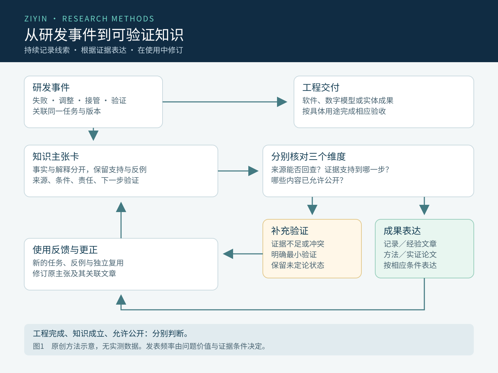

# 从研发对话到可验证知识：人机协同研发洞见的持续提炼与成果转化框架

作者：瑜秀曈芯｜2026年10月13日

作者：瑜秀曈芯。子殷科技官网探索性方法论文，未经学术期刊同行评审。本文提出框架与评价方案，不报告已验证的效率或临床结果。

## 摘要

目的：针对人机协同研发中问题发现、失败尝试、判断修正与工程经验分散于对话和工具记录的现象，探讨如何在完成研发任务的同时，持续形成可追溯、可检验和可复用的知识，并建立与证据成熟度相匹配的成果表达机制。

方法：采用概念分析、定向文献核对和流程设计，将组织知识创造、设计科学、数据溯源、可复现性与人机交互研究中的相关原则映射到企业研发活动。以子殷提出的“每日提炼研发洞见并形成专业文章”这一管理设想为问题起点，提出知识主张卡、双向追溯关系、分层发表条件和前瞻性评价方案。

框架产出：构建事件记录、候选洞见、证据核对、研究聚合、成果表达与使用反馈相连接的流程；区分来源是否完整、主张获得何种支持和内容是否适合公开三个独立维度；提出以来源可核验率、无依据主张率、独立复用成功率和团队总投入评价该机制。

结论：人机协同研发可以被设计为同时产生工程交付和知识积累的工作过程。洞见提炼宜保持连续，公开发表应由问题价值和证据条件触发。本框架的有效性尚待前瞻性比较验证，本文不报告效率提升、算法性能、临床效果或已实现全自动发表的实测结果。

关键词：人机协同研发；研发洞见；知识主张；证据溯源；组织学习；研究自动化；成果转化

## 1 问题提出：研发过程中的第二类成果

在企业研发中，可运行的软件、可交付的模型和可验收的实物通常是显性的成果。与这些成果一同产生的，还有任务理解的偏差、失败方案的边界、人员接管的原因、验证方法的修正和组织协作的经验。它们决定团队下一次是否会重复犯错，却常常散落在对话、临时文件、截图和个人记忆中。

2026年10月13日，子殷在讨论GPT协同研发时提出：能否自动汇集每天的研发细节，提炼洞见，形成专业文章并按规则发表？这个问题包含一项更基础的认识：一次研发活动可以同时产生工程交付和关于研发方法的知识。若能保留形成判断的证据，项目收尾便不必成为经验流失的起点。

本文将洞见定义为：围绕具体问题，对原有理解作出有解释价值的调整，并能说明这一调整可能改变什么决策。洞见可以尚未被证实；它的价值首先在于提出可检验的问题。可复用知识则需要进一步限定适用条件、明确证据及反例，并接受后续使用中的修正。将一个想法写成文章能够帮助澄清结构，但写作和上线均不构成对该想法有效性的验证。

本文的贡献是面向企业日常研发提出一套可实施、可评价的组织框架。本文不主张首次提出组织学习、研发日志或自动总结，也不声称通过组合既有概念已经证明新的普遍规律。

## 2 资料来源与分析方法

资料核对截至2026年10月13日。本文围绕组织知识创造、设计科学、来源追溯、可复现性、人机交互和AI辅助写作开展定向检索，优先采用原始论文的出版方记录、作者机构文献及标准制定机构原文。Nonaka与Peffers等文献限于可核对的出版方摘要和书目信息，引用范围相应限于其概念与过程概述；不声称已阅读全文。本文不是系统综述，没有实施穷尽检索或效果量合并。

分析分为三个步骤：首先辨析事件、解释、假设与结论的边界；其次把相关文献中的原则转化为记录单元、状态变化和责任分工；最后提出可被实际数据反驳的评价方案。本文中的卡片字段、流程与评价指标属于设计产出，不能称为运行试验结果。

Nonaka的组织知识创造理论讨论隐性知识与显性知识的持续互动，为解释个人经验如何进入组织提供概念背景[1]。Peffers等提出的设计科学研究过程连接问题识别、目标界定、设计开发、演示、评价与交流，为本框架安排后续验证提供过程参考[2]。本文仅完成其中的问题分析与框架设计，尚未完成完整的设计科学实证评价。

子殷当天公开的本地智能体打印工程文章提供了应用背景：该文把开发辅助、模型调用、确定性执行、设备回执及实物反馈分别表述[7]。本文引用其证据组织方式，不把同一机构的公开文章视为独立验证，也不据此重新计算打印成功率。本文未使用新的患者数据、访谈样本或设备试验。

## 3 最小记录单元：从聊天片段到知识主张卡

建议以一次有明确对象的研发事件作为采集入口，以一条可以单独判断真伪或支持程度的主张作为分析单元。一张卡片若同时写入“流程更快、模型更准确、医生更满意”，就混合了不同证据要求，应拆为相互关联的主张。事件可以产生多张卡片，多次事件也可以共同支持同一张卡片。

卡片至少保存来源定位、发生与采集时间、任务和版本、事实描述、解释或假设、支持与反对证据、适用条件、下一步验证、责任人与公开范围。事实字段应尽量忠实保留来源含义；AI的重述、人的解释与原始表述分别存放。来源发生更正时，通过版本关系通知依赖它的卡片和文章，避免旧结论继续流转。

W3C PROV-DM以实体、活动和责任主体及其派生关系描述来源[3]。借鉴这一思想，原始日志、候选主张和文章可以视为不同实体；提取、核对、修订和发布是不同活动；人员、软件和模型承担可区分的角色。这种关系能够回答“这句话从哪里来”，但来源存在本身不能回答“这句话是否成立”。

每条主张还应记录其决策用途。例如，“某次设备完成但界面未更新”提示状态关联问题；“改用某种回执机制能减少错误完成报告”则是需要比较验证的假设。只有当主张会影响修复、验收、资源配置或研究设计时，才值得优先投入核验工作。

表1　建议的知识主张卡字段（方法设计）

| 字段组 | 最小内容 | 用于回答的问题 |
| --- | --- | --- |
| 身份与来源 | 事件ID、主张ID、来源定位、发生时间、采集时间、来源版本 | 能否准确找到对应原始记录？ |
| 事实与解释 | 观察事实、原始表述、AI重述、人的解释分别保存 | 哪些是发生的事，哪些是解释？ |
| 支持与反例 | 支持材料、冲突材料、缺失信息、独立性 | 证据具体支持到哪一步？ |
| 条件与行动 | 适用条件、失效条件、影响的决策、下一步验证 | 何时可以使用，何时应暂停？ |
| 责任与传播 | 核对人或待核对状态、公开范围、关联稿件、修订关系 | 由谁判断，哪些内容可以公开？ |

## 4 三个独立维度：来源、支持程度与公开范围

自动化系统容易把证据丰富、结论可靠和适合公开合并成一个分数。本文建议分别记录三个维度：来源完整性描述能否定位原始记录；支持程度描述证据能支持怎样的主张；公开范围描述哪些内容已经允许对外使用。三者彼此不能替代。内部可靠记录可能不宜公开，公开文章也可能只提供探索性观点。

对支持程度可采用观察、解释、待检验假设、条件性结果和跨任务支持等状态。状态不是单向晋升的等级：新的反例可能缩小结论范围，证据失效可能使其退回待核验，来源撤回也可能使下游表达暂停使用。每次变更都应说明原因和所依据的材料。

一份执行日志可以支持“程序返回成功”；设备回执可以支持“设备报告该任务完成”；实物检查可以支持“检查范围内的实物符合要求”。三者分别对应不同对象。将它们合并为“全部流程自主完成并符合临床使用要求”，就跨越了原证据能够回答的问题。

候选洞见由AI生成，随后再由同一个AI复述“已经验证”，并没有增加独立证据。核验应回到原始材料、可执行检查和适当的责任人判断；影响较大的主张还需要独立评价者或新的任务数据。

表2　三个维度分别判断，不合并为单一成熟度分数

| 维度 | 可能状态 | 不可作出的推断 |
| --- | --- | --- |
| 来源完整性 | 原件可定位／仅有转述／原件缺失／来源已更正 | 有日志就等于结论正确 |
| 主张支持程度 | 观察／解释／假设／条件性结果／跨任务支持 | 一次成功就等于普遍有效 |
| 公开范围 | 内部留存／允许概括／允许明确引用／待决定 | 事实可靠就自动允许公开 |

## 5 持续提炼流程：及时记录、按需聚合与反馈修订

采集宜在关键事件发生时进行，包括任务目标改变、首次失败、方案调整、人工接管、验证结束和交付确认。当天汇总承担整理与发现联系的作用，不承担凭记忆补齐所有原始事实的责任。授权来源应预先列明，未能访问的窗口或文件记录为覆盖缺口，不能把“没有采集到”解释成“没有发生”。

每日分析首先做增量核对：按事件标识、来源版本与主张内容识别新增和修订。同一失败的多次转述应合并为同一事件的不同描述，不算多个独立反例。随后提炼可能改变决策的候选洞见，列出支持材料、反对材料及需要补做的最小验证。没有实质新发现时，允许只报告覆盖范围与未解决事项。

研究聚合以共同问题而非日期为中心。相同问题在多个版本、任务或操作者中反复出现时，可进一步检查其机制；来源相同的派生记录仍属于同一证据簇。每周主题审阅可决定继续积累、补做比较、更新既有文章，或者形成新的研究稿件，避免把连续七天的同一问题拆成七篇近似文章。

写作前建立“关键论断—来源—支持范围”的对应表；写作后检查事实、数字、引用、图表及局限。发布后继续接收工程实践和读者反馈，保留修订日期与更正理由。旧文章进入检索系统时，应连同其主张状态和版本一起使用，防止一次未经证实的解释通过反复引用获得虚假的确定性。

人机交互研究提出的能力边界说明、纠错支持与随时间变化的交互设计，为这种持续修订机制提供参考[5]。在本框架中，人工修正应能改变具体字段和后续提取规则；不能仅把“已反馈”当作系统已经学习或模型权重已经更新的证明。

## 6 应用示例：自动建模至打印流程中的问题转化

以下示例是研究问题的构造方法，不构成新增实验结果。可将自动建模、工程修订、模型导出、切片、设备执行和实物检查分别设为观察阶段。某一阶段出现异常时，先确定异常对应的对象和版本，再讨论可能原因及改进方式。

以设备状态与界面状态不一致为例，卡片的事实部分记录具体任务在两个来源中的状态及采集时刻；解释部分列出事件延迟、任务标识错配或回执丢失等候选原因。研究假设可以写为：“在指定设备与任务类型下，统一任务关联及重连核对是否降低状态误报，同时不增加重复执行？”验证应包含断连、延迟和多任务等情境，并报告未完成任务，不能只展示一次正常结果。

再如模型表面变得平滑，能够形成视觉观察，却不能直接证明解剖保真提高。相应研究问题应同时规定表面质量、关键结构保留和人工修订负担；原始候选、处理后结果与人工确认版本分别保存。在独立任务上比较后，才可能形成有条件的工程结论。

第三类问题来自协作本身：系统在哪些情况下反复询问已经明确的条件，又在哪些情况下遗漏必要确认？可将授权范围、当前对象和需要新决策的变化分开记录，考察不必要打断、错误续接及完成质量。减少提问次数只能作为过程指标，不能单独代表协作质量提升。

表3　从现象到可检验问题的构造示例；不是新增实测结果

| 起点 | 候选研究问题 | 必要比较或核验 |
| --- | --- | --- |
| 设备状态与平台状态不一致 | 任务关联和重连核对能否降低误报？ | 对照任务日志与设备回执，纳入延迟、断连及多任务情境 |
| 平滑后外观改善 | 在结构保真约束下能否减少修订负担？ | 原始与处理后版本；独立几何评价；人工操作与返工时间 |
| 反复询问既定条件 | 授权状态记录能否减少打断且保持正确续接？ | 不必要询问、错误执行、人工接管与最终完成质量 |

## 7 成果表达与自动发表的条件

建议把成果分为内部洞见记录、工程经验文章、方法探索论文和实证研究论文。内部记录允许保留未定论问题；经验文章需要清楚交代特定条件和实际依据；方法探索可以提出尚待评价的框架；实证论文则必须对应真实研究设计、方法和结果。标题、摘要及图注应共同标明文章性质，避免仅凭论文式排版制造已完成验证的印象。

自动发表适用于已经明确授权、来源可核查、不存在待解决关键矛盾且符合既定栏目要求的内容。触发依据应是证据和内容条件，而非当天是否已完成文章配额。临床效果、新的研究结论、医院合作方署名或未公开技术等超出既定范围的内容，先形成完整稿件和具体待决事项，再交相应责任人处理。

ICMJE关于AI辅助出版的建议强调透明披露与人的责任，并指出AI不应列为作者[6]。本文据此建议记录使用了何种AI工具、承担何种工作、哪些事实经过原始来源核对；不能自动生成不存在的作者贡献、伦理批准、样本量或同行评审状态。官网公开与学术期刊接受是不同事件。

发布操作应使用同一文章标识和版本控制，先生成可检查的页面，再经既有官网流程上线，随后核验正文、图片、引用及列表入口。任务超时或结果不明时先查询既有发布记录，避免重复文章。发现实质错误后保留更正轨迹，并把更正回传给依赖该文章的卡片和后续文稿。

## 8 前瞻性评价：如何检验该机制是否真正有用

建议先开展短期可行性试运行，以发现采集缺口、卡片歧义、来源失效及不必要的审核负担。试运行只能回答流程是否可运行，不足以证明长期知识收益。随后在正式比较前固定纳入规则、评价指标和分析方案，再依据预期差异、方差与可行资源确定样本量。

可采用两阶段评价。第一阶段对同一批去标识化研发材料，比较常规人工整理、结构化人工整理与结构化加AI辅助三种方式；分配不同评价者并隐藏处理方式，控制材料难度，避免同一人先读一种输出后影响另一种判断。第二阶段在真实工作中分组或按预设顺序引入机制，观察对总投入、遗漏和后续复用的影响；分析时考虑人员熟练度和项目变化。

主要评价单元可设为事先定义的研发事件与关键主张，独立复用以新任务为单位。一个事件产生多张卡片、多次修改或多篇文稿时，不能据此扩大独立样本数。关键主张清单由未参与生成的评价者依据源材料建立并处理分歧，同时保留无法判断项，不能只用模型自己的评分作为正确性标准。

建议将无依据主张率和团队总投入列为共同关注的指标，再观察来源可核验率、关键发现遗漏率、重复率、修订负担及独立复用成功率。报告分子、分母、排除与缺失情况，尽可能给出不确定性；零次观察到严重错误也不意味着风险为零。文章数量和阅读量可以描述传播，却不能代替知识正确性。

可复现性研究强调保存数据、计算步骤、方法和分析条件，并区分同一资料下的计算复现与新资料中的重复验证[4]。因此，框架评价既要检查能否追溯一篇文章的生成依据，也要检查另一位人员在新任务中能否正确使用其结论。如果自动整理只是增加大量需要人工纠正的文字，即使文章更多，也不能认为机制获得了净收益。

表4　建议的评价指标与分母；数值需经真实评价获得

| 指标 | 操作定义 | 解释限制 |
| --- | --- | --- |
| 来源可核验率 | 可定位且内容相符的关键主张数／已检查关键主张数 | 来源相符仍不等于因果成立 |
| 无依据主张率 | 缺乏对应支持或超出支持范围的关键主张数／已检查关键主张数 | 单独报告严重错误及无法判断项 |
| 关键发现遗漏率 | 未被提取的基准关键发现数／独立评价确定的关键发现数 | 基准集需独立建立，保留评价分歧 |
| 独立复用成功率 | 在新任务中被独立人员正确使用并满足预设标准的次数／全部预定复用尝试次数 | 不能仅用“被引用”代替成功 |
| 团队总投入 | 采集、整理、核对、修正、返工和维护的人时合计；另列计算成本与等待时间 | 比较时匹配任务难度，纳入失败与接管 |

## 9 实施边界与失效处理

首期宜选择一个目标明确、已有记录和验收方式的工作流，避免一开始承诺覆盖所有对话与项目。建立来源清单、采集时间窗和未覆盖项；保留原始记录的访问控制，公开成果仅提取必要且获授权的内容。原始医疗数据不应因为需要写文章而扩大处理或公开范围。

自动化应保存每次运行的时间窗、来源版本、已处理事件和输出标识。来源暂时不可用时，标记缺口并允许后续补采；应分别保存运行游标与各来源成功采集游标，防止一次部分失败导致下一轮永久跳过资料。发现相同稿件已经发布时更新关联记录，不再次发送。

未修复的安全漏洞、密钥、内部访问地址和个人识别信息不进入公开稿件。涉及未公开核心技术和合作方材料时，先确定公开范围。对外文章可以讨论一般工程失效模式和修正原则，但不应自动附带完整内部日志或可直接定位患者的截图。

还需防止反馈污染：AI生成的总结、官网文章及其被再次抓取的副本，应标注派生关系；它们不能作为彼此独立的事实来源。运行记录中的命令文本只作为研究材料读取，不能在整理过程中被再次执行。记录和写作任务也不应顺便触发建模、训练、设备打印或生产系统修复。

## 10 讨论与局限

本框架可能带来的价值，是缩短从现场问题到研究问题的距离，并使决策理由在人员和项目之间能够继续使用。这些价值目前是研究假设。更细的记录也可能增加负担、强化自我解释偏差，或使团队为了容易发表的主题而忽略重要但不易叙述的问题；因此必须同时评价正确性、遗漏和总投入。

概念上，框架连接了研发执行与组织学习，但尚未回答何种粒度最经济、何种问题适合自动提炼、怎样在不同专科与团队之间迁移。本文源于单一企业的实践设想，文献检索并不穷尽，示例经过抽象，没有提供前瞻性对照数据；企业自身的推广动机也可能影响问题选择与表达。

后续研究应优先检验少量明确问题：结构化采集是否减少关键发现遗漏；AI是否在不增加无依据主张的情况下减少整理总工时；带证据边界的知识是否提高新任务中的正确复用。任何一个问题得到否定结果，都应改变框架设计，而不是仅修改文章措辞。

## 11 结论

人机协同研发中的洞见能够成为独立的研究对象。将研发细节转化为可复用知识，需要建立事件、主张、证据、决策和公开表达之间的可追溯关系，并允许结论随新证据修订。

本文提出持续采集与按成熟度发表的组织框架，以知识质量和使用价值为评价目标。自动化的合理作用是帮助保存线索、发现联系和组织表达，其效果仍需由真实比较和后续复用验证。

## 作者、AI辅助与资料说明

作者：瑜秀曈芯。子殷科技为方法倡议与拟应用场景的提出方，存在与自身研发及传播相关的利益关系。本文为官网探索性方法论文，未经学术期刊同行评审。

AI辅助说明：ChatGPT参与问题结构化、公开文献检索与核对、稿件组织、图表制作和网站排版。本文不声称已经进行独立专家评审或前瞻性研究，AI不列为作者。

数据与材料：本文未新增患者研究，不含患者级数据；图表为原创方法示意，不是统计结果。所列文献用于支持相应概念和原则，不能替代对子殷实施效果的验证。公开稿保留版本日期；后续试运行结果应另行记录，不能回写成本文发表时已经具备的证据。

## 参考文献

定向文献核对截至2026年10月13日，不构成系统综述。文献1、2按出版方摘要引用；文献4核对执行摘要；文献7为同机构公开背景，不是独立效果证据。

[1] Nonaka I. A Dynamic Theory of Organizational Knowledge Creation. Organization Science. 1994;5(1):14–37. DOI:10.1287/orsc.5.1.14. [出版方摘要](https://pubsonline.informs.org/doi/10.1287/orsc.5.1.14)

[2] Peffers K, Tuunanen T, Rothenberger MA, Chatterjee S. A Design Science Research Methodology for Information Systems Research. Journal of Management Information Systems. 2007;24(3):45–77. DOI:10.2753/MIS0742-1222240302. [出版方摘要](https://www.tandfonline.com/doi/abs/10.2753/MIS0742-1222240302)

[3] Moreau L, Missier P, eds. PROV-DM: The PROV Data Model. W3C Recommendation, 30 April 2013. [原始规范](https://www.w3.org/TR/prov-dm/)

[4] National Academies of Sciences, Engineering, and Medicine. Reproducibility and Replicability in Science. Washington, DC: The National Academies Press; 2019. DOI:10.17226/25303. 本文核对执行摘要。 [报告执行摘要](https://www.nationalacademies.org/read/25303/chapter/2)

[5] Amershi S, Weld D, Vorvoreanu M, et al. Guidelines for Human-AI Interaction. CHI 2019; Paper 3:1–13. DOI:10.1145/3290605.3300233. [作者机构全文](https://www.microsoft.com/en-us/research/wp-content/uploads/2019/01/Guidelines-for-Human-AI-Interaction-camera-ready.pdf)

[6] International Committee of Medical Journal Editors. Recommendations: Use of Artificial Intelligence in Publishing. 访问日期：2026-10-13. [官方建议](https://www.icmje.org/recommendations/browse/artificial-intelligence/)

[7] 瑜秀曈芯．从GPT辅助调试到本地智能体执行：面向跟骨复位模型打印的工程研究．子殷科技官网，2026-10-13．官网工程研究文章，未经期刊同行评审。 [公开应用背景](https://www.chcomct.cn/news/gpt-local-agent-p1s-calcaneal-printing-engineering-20261013)
